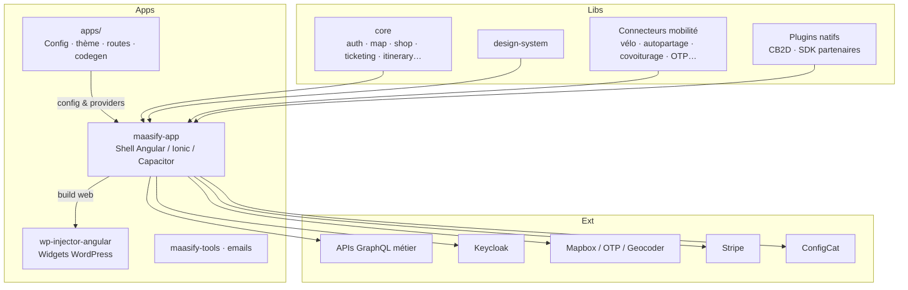

# MONKEY
[Angular/TypeScript] Applications Maasify pour Monkey Factory

# MaaSify — Plateforme Mobility as a Service

> **Note légale**  
> Le code source de ce projet appartient à mon ancien employeur et **ne peut pas être publié**.  
> Ce dépôt documente uniquement le contexte produit, l’architecture, les choix techniques et les compétences acquises.  
> Aucun secret, clé API, configuration client sensible ou extrait propriétaire n’est inclus.

---

## Contexte du projet

Le **MaaS** (*Mobility as a Service*) consiste à regrouper dans une seule application la planification, la réservation, le paiement et la validation de plusieurs modes de transport (bus, tram, vélo en libre-service, autopartage, covoiturage, recharge, etc.).

Le dépôt d’origine est un **monorepo frontend** (~30 apps réseaux + ~50 libs partagées) qui alimente des applications **iOS, Android et web (widget wordpress)**.

> Durant mes 5 années dans l'entreprise Monkey Factory, j'ai évolué en tant que développeuse Angular/TypeScript. J'ai participé aussi bien au développement de nouvelles fonctionnalités, qu'à la maintenance ou bien la mise en production des applications notamment sur les stores.

### Captures d'écrans

Chaque application est adaptée et enrichie en fonction des besoins des collectivités, certaines fonctionnalités comme les horaires ou la carte interactive sont communes aux applications, et d'autres sont essentiellement spécifique à un réseau (billetique, services de mobilités, ...)

### Les applications déployées sur lesquelles j'ai travaillé :

- Mon Compte Mobilité (Mulhouse)
- BeeMob (Arcachon)
- Grand Reims Mobilité (Reims)
- Optymo Mobilité (Belfort)
- SunuBRT (Dakar)
- Ycéo (Saint-Nazaire)

Mais aussi : Cambrai, Béziers, Briey, Cavaillon, Cayenne, Cluses, Concarneau, Creusot-Montceau, Epinal, Evian, Fougères, Roanne, Rodez, Roissy, Royan, Saint-Avold, Saint-Dié, Vaucluse, Verdun

Toutes ces applications sont issues du même monorepo maintenu par une équipe de 3 à 5 développeurs front-end.

*Une même codebase, des configs white-label, déploiements multi-canaux*.

---

### Stack cœur

## Stack technique

| Couche                    | Technologies                                                                              |
| ------------------------- | ----------------------------------------------------------------------------------------- |
| **Runtime app**           | Angular 17, Ionic 6, Capacitor 7, TypeScript 5.4                                          |
| **Monorepo**              | Bun workspaces, Nx (lint / test / affected), scripts maison                               |
| **Données**               | GraphQL, Apollo Angular (multi-clients), GraphQL Codegen, WunderGraph Cosmo (schemas)     |
| **Auth**                  | Keycloak (OIDC), biométrie native (Capacitor)                                             |
| **Paiement**              | Stripe (web + Capacitor)                                                                  |
| **Cartographie / trajet** | Mapbox GL, Turf, OTP, géocodeur dédié                                                     |
| **État local**            | Ionic Storage / IndexedDB, Service Worker (PWA web)                                       |
| **Design**                | Design system interne + Storybook                                                         |
| **Qualité**               | ESLint, Prettier, Vitest, lint-staged, check i18n Nx                                      |
| **Observabilité**         | Sentry (Angular + Capacitor), analytics (Firebase / GTM / Plausible)                      |
| **Feature flags**         | ConfigCat                                                                                 |
| **CI/CD**                 | GitLab CI (`nx affected`), Firebase Hosting, Azure Blob (trads / widgets), stores manuels |
| **OTA**                   | Capgo CapacitorUpdater                                                                    |
| **Autres**                | React (outils internes, emails), widgets WordPress (injecteur Angular)                    |

**Hors périmètre de ce monorepo** : les backends GraphQL (APIs métier) sont consommés en clients ; ils vivent dans d’autres dépôts.

---

## Architecture

### Vue d’ensemble monorepo

